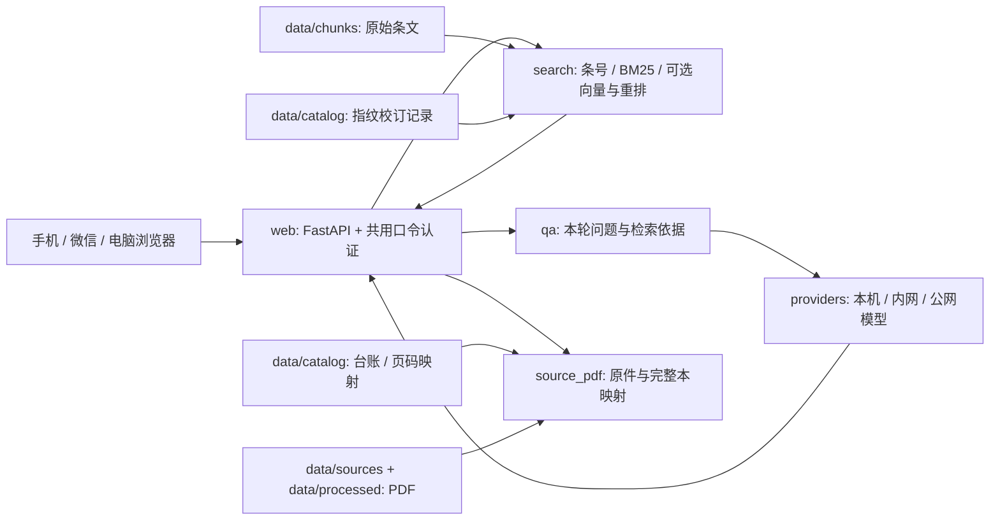
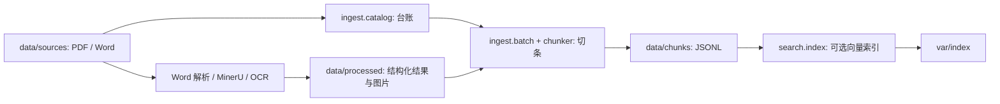

# 项目结构与数据流

本地工程和 GitHub 主分支共用一套布局。应用安装为 `building_kb` Python 包，全部命令从项目根目录运行；文件位置由 `src/building_kb/paths.py` 统一管理，不再依赖先 `cd kb`。

## 查询链路

`web` 负责 HTTP、Cookie、SSE 和页面；`search` 负责检索；`qa` 负责组织回答依据；`providers` 统一模型调用。每轮追问重新检索，历史回答只辅助指代，不替代本轮证据。原始条文保持不改，人工校订通过指纹匹配应用；内容变化会使既有核对记录失效。

## 入库链路

有对应 Word 时优先保留条号与表格，用 MinerU/PDF 回填页码；没有 Word 才从 OCR 结果切条。`data/processed/` 是需要保留的加工资料，不能当成可随意清空的缓存。`var/cache/`、`var/index/` 才是可重建运行产物。

## 各目录的边界

| 目录 | 版本管理与用途 |
| --- | --- |
| `src/`、`tests/`、`scripts/`、`config/` | Git 跟踪代码、回归与模板；真实 OCR 机器配置不提交 |
| `data/catalog/`、`data/chunks/`、`data/manifests/` | 私有 Git 跟踪的小体积协作数据和规则 |
| `data/sources/`、`data/processed/` | 大文件放私有 Release，本地按同样路径恢复 |
| `examples/demo/`、`examples/public/` | 虚构样例与独立的 16 本公开开发快照，不替换默认全库 |
| `docs/architecture/` | 当前结构和认证说明 |
| `docs/development/` | 接手、维护命令、计划、目录迁移 |
| `docs/data/`、`docs/acceptance/` | 资料目录、恢复、字段与验收记录 |
| `docs/history/` | 原架构图和实施记录，仅作历史参考 |
| `var/` | 每台电脑自己的模型、缓存、日志、队列和生成校对页 |
| `archive/` | 本机旧工程、上传中间文件、迁移前备份；不提交 |

## 配置

默认以源码所在项目为工作目录。安装包部署到别处时设置 `KB_HOME` 指向包含 `data/`、`config/`、`.env` 的工作目录。`KB_CATALOG`、`KB_CHUNKS`、`KB_WORD_DIR`、`KB_MINERU_DIR`、`KB_OCR_DIR`、`KB_MODELS_DIR`、`KB_INDEX_DIR`、`KB_PAGE_CACHE` 可覆盖各路径；相对值均相对于工作目录，显式命令行文件参数则按终端当前目录解析。

原始规范 PDF、OCR 合并定位副本和完整阅读本承担不同用途：它们可能页数不同，不能仅按文件名互换。`data/catalog/source_documents.json` 保存完整本映射；`verification.json` 保存选定条文核对；整库当前效力状态仍待核。
