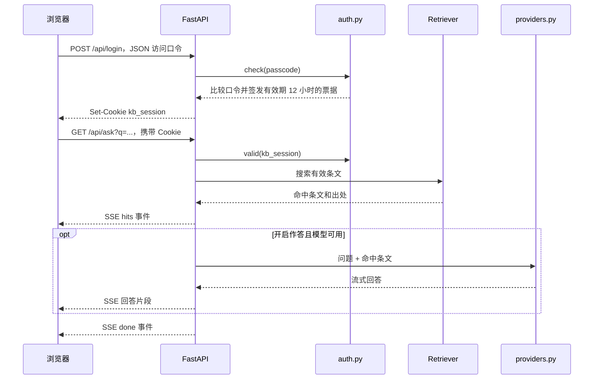

# 认证与请求流程

本文以当前源代码为依据；架构目录中的图包含历史运行状态，具体能力以代码和实际配置为准。

## 组件

| 组件 | 代码 | 职责 |
| --- | --- | --- |
| H5 页面 | `kb/app/static/index.html` | 输入访问口令、查询、显示条文和流式回答 |
| 访问认证 | `kb/app/auth.py` | 验证共用口令，签发、核验到期票据 |
| HTTP 服务 | `kb/app/main.py` | 路由、Cookie、访问校验和 SSE 输出 |
| 检索 | `kb/src/retrieve.py` | 条号直达、BM25、可选向量和重排 |
| 回答 | `kb/src/answer.py` | 组织检索上下文与引用要求 |
| 模型适配 | `kb/src/providers.py` | 本机模型、内网接口或公网模型的配置与调用 |
| 原件定位 | `kb/src/source_pdf.py` | 台账与解析结果映射到源 PDF |

## 登录与查询

未认证时，查询、书目、条文详情与原件接口返回 401。首页可访问；`/api/status` 未认证时只返回 `authed`。

## 凭据和票据

- **访问口令 `KB_PASSCODE`**：全员共用，不是个人账号。启动时要求已经进入环境变量；开发入口 `run_dev.py` 可随机生成一次性开发口令。
- **签名密钥 `KB_SECRET`**：用于 HMAC-SHA256。未设置时每个进程随机生成，重启或换进程后旧票据失效；多进程必须配置同一签名密钥。
- **会话 Cookie `kb_session`**：内容为 `到期时间.HMAC签名`，不是 JWT。服务端不存会话表、不记录用户身份。有效期 12 小时。Cookie 带 `HttpOnly`、`SameSite=Lax`；`KB_HTTPS` 非空时加 `Secure`。
- **退出**：`POST /api/logout` 清除浏览器 Cookie。没有服务端单张票据撤销机制；只改访问口令不会撤销已经签发的有效票据。需要全员失效时轮换签名密钥并重启全部进程。
- **模型密钥**：`DEEPSEEK_API_KEY`、`SILICONFLOW_API_KEY`、`KB_LOCAL_API_KEY` 供服务端调用。`MINERU_TOKEN` 供云端 OCR 工具调用。它们不应写进前端或上传仓库。

`providers.py` 按需读取 `kb/.env`；认证模块在导入时就取得签名密钥，启动时读取口令。因此正式启动请使用 README 的 `--env-file .env`，确保配置在导入应用之前加载。

## 数据出网边界

默认 embedding 和 rerank 使用本机模型；没有模型或索引时可降级为 BM25。默认作答提供方是 DeepSeek，只有配置密钥并启用作答后才调用。

使用公网模型时，问题和检索命中条文可能发往模型服务。`tools/ocr_cloud.py` 会上传待识别 PDF 到 MinerU。需要留在内网的数据，应使用本机/内网提供方，并避免云端 OCR。

当前访问控制适合小规模内部试用：没有个人账号、权限分级、登录限流或逐票撤销。部署到服务器前应配置 HTTPS、访问范围和反向代理限流。`HttpOnly` 限制脚本读取 Cookie，但不能阻止 XSS 代用户发起请求。
